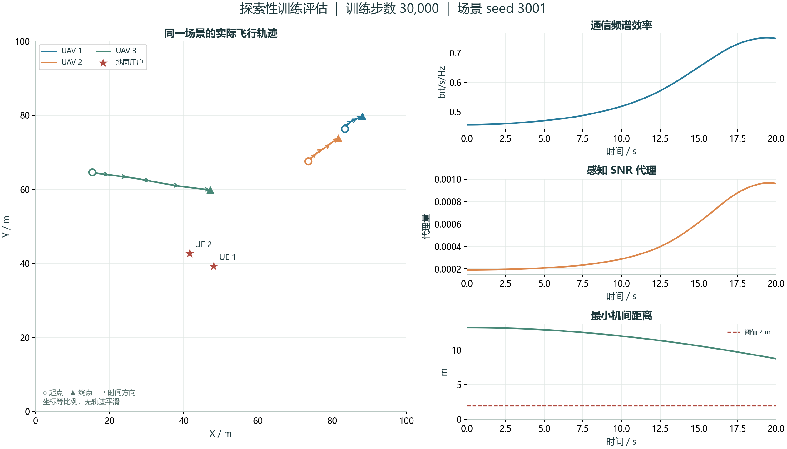

# AA-MAPPO · 无人机通感协同研究工作台

**论文、历史实验档案、维护版实现与交互展示，在同一仓库中维护。**

[论文 DOI](https://doi.org/10.1109/ICCECT68671.2026.11565262) · [研究工作台](https://gjy1024.github.io/AA-MAPPO/) · [方法说明](docs/METHOD.md) · [复现指南](docs/REPRODUCIBILITY.md) · [实验协议](docs/EXPERIMENTS.md) · [实现审计](docs/IMPLEMENTATION_AUDIT.md)

> 本仓库把三类内容分别标注：**历史单次训练记录**、**发表后维护版**、**规则控制教学示例**。维护版修正了实体注意力与环境实现选择，需要重新训练；随仓库提供的512步短训练仅证明流程可运行，不宣称复现原论文性能。

## 先了解项目

本项目研究固定高度下多无人机的连续轨迹决策。Actor根据本地可用观测输出加速度，训练阶段的集中Critic利用全局状态估计价值；多头注意力聚合实体信息，PPO/GAE用于策略训练，奖励考虑通信、感知代理、碰撞与速度代价。

- **交互平台**：轨迹播放/拖动/选机、JSON导入导出、训练与执行切换、Softmax教学实验、真实历史曲线浏览。
- **维护版 `aamappo/`**：多实体token、Actor/Critic四种注意力消融、有界连续动作、独立随机数生成器、GAE与tanh高斯策略、统一训练/评估入口。
- **历史材料**：4组原始训练日志、24份Actor/Critic检查点、16张研究结果截图，以及源文件SHA-256索引。
- **维护机制**：明确配置、单元检查、短训练验收、数据来源、GitHub Actions与Pages工作流。

本文方法来自已发表论文，基础算法继承MAPPO/PPO/GAE/CTDE。新维护代码不是旧模型的无差别替换；历史单token实现的局限和维护决策见[审计文档](docs/IMPLEMENTATION_AUDIT.md)。

## 本次实际改进：独立测试20个场景

按验证集预先选择长rollout配置，随后仅评估一次固定测试集3001–3020；每个学习策略只有训练seed7。

| 指标 | 512步短训练 | 改进PPO，30,000步 |
| --- | ---: | ---: |
| 通信频谱效率，bit/s/Hz | 0.760 | 1.141 |
| 感知代理 | 0.002091 | 0.003516 |
| 含碰撞回合 | 6/20 | 0/20 |
| 触边回合 | 20/20 | 0/20 |
| 平均回合回报 | -293.05 | 291.02 |

这组探索结果较短训练改善，尚不能证明多训练种子稳定性或绝对安全。非学习环形规则参考的平均回报为742.30，仍高于当前PPO；原配置30k与示范预训练的失败结果均保留。完整协议见[探索实验](docs/PILOT_STUDY.md)，测试选择与所有回合见`artifacts/final-test/`及[回放压缩档案](artifacts/replay-archive.zip)。



## 1. 只看网站：无需安装PyTorch

```bash
python scripts/serve.py --port 8000
```

在浏览器访问 **http://localhost:8000**。也可直接打开 `site/index.html` 使用内置教学交互；历史JSON档案读取需要HTTP服务器。网站不需要账号、API key、数据库或CDN，导入文件只在本地浏览器处理。

GitHub Pages部署源为 `site/`，对应工作流在[pages.yml](.github/workflows/pages.yml)。首次启用步骤见[维护指南](docs/MAINTENANCE.md)。

## 2. 安装与最小复现闭环

推荐Python **3.10**，Windows/Linux均可；维护版只依赖NumPy和PyTorch，不依赖旧Gym、wandb或TensorBoard。

先选择Python 3.10解释器，再执行下面命令。`python`可能指向其他版本；以下断言会先检查版本。Windows可通过`py -0p`查看已注册解释器，未列出3.10时需要先安装或用3.10的完整路径创建虚拟环境；使用Conda也可运行`conda env create -f environment.yml`和`conda activate aa-mappo-research`。

```bash
python -c "import sys; assert sys.version_info[:2] == (3, 10), 'Select Python 3.10 first'"
python -m venv .venv
# Windows PowerShell:
.venv\Scripts\Activate.ps1
# macOS / Linux:
# source .venv/bin/activate
python -m pip install -r requirements-tested-cpu.txt
python -m unittest discover -s tests -v
python -m aamappo smoke --config configs/maintenance.json --steps 512 --out runs/smoke-001
python -m aamappo evaluate --checkpoint runs/smoke-001/checkpoint.pt --seeds 1001 1002 1003 --out runs/smoke-001/reloaded-evaluation.json
```

`requirements-tested-cpu.txt`记录本地验收使用的直接依赖版本：Python3.10.5、PyTorch2.7.0+cpu、NumPy2.2.6。它不是包含全部传递依赖的锁文件，不保证跨硬件逐比特一致。GPU用户按PyTorch官方渠道安装对应版本并记录环境。

每次训练保存：`config.json`、`provenance.json`、`metrics.jsonl`、`checkpoint.pt`和`evaluation.json`。输出目录非空时拒绝覆盖。将 `evaluation.json` 拖入网页的“导入运行JSON”入口即可回放。

## 3. 完整训练与消融计划

```bash
python -m aamappo train --config configs/maintenance.json --attention-mode both --seed 1 --steps 2000000 --out runs/both-seed1
python -m aamappo sweep --config configs/maintenance.json --seeds 1 2 3 4 5 --steps 2000000 --dry-run
```

`sweep`默认只打印计划。显式加 `--execute` 才启动全部训练；四种模式为 `none / actor / critic / both`。默认4×5=20次训练可能较耗时，先评估单次计算预算。提供计划不等于这些实验已经完成。

可在JSON配置中设置 `no_clip: true` 进行真正不使用PPO裁剪的对照，或设置 `reward_mode: "naive"`。比较不同奖励训练出的策略时，仍需使用统一的通信、感知、安全等外部指标。参数量不同会写入运行来源记录，注意力与MLP比较仍需进一步参数量匹配。

## 4. 数据与结果来源

| 内容 | 位置 | 能说明什么 |
| --- | --- | --- |
| 历史原始日志/检查点 | `artifacts/legacy/` | 原目录标签下的单次运行；完整配置、seed和论文逐图对应待确认 |
| 历史代码变体 | `legacy/variants/` | 用户提供的4组核心代码快照，保留原貌 |
| 原始代码文件哈希 | `legacy/SOURCE_SNAPSHOT.json` | 标识提供的文件，不能自动证明某文件生成某条曲线 |
| 维护版512步短训练 | `artifacts/maintenance-smoke-v2/` | 新实现的训练、保存、重新加载和评估闭环 |
| 网页历史曲线 | `site/data/legacy-training.json` | 确定性转换原JSON；保留异常峰值，不生成虚构置信区间 |
| 网页规则教学回放 | `site/data/demo.json` | 展示机制、场景与数据接口，不是训练策略 |

历史检查点与新架构不兼容，维护版加载器会拒绝它们。网页回放只展示所选评估的首个场景，汇总统计的样本单位另行声明。多次评估回合不等于多个独立训练种子。

重新导入你自己的原始材料：

```bash
python scripts/import_legacy.py --source "原始AA-MAPPO_Project目录"
python scripts/build_site_data.py --evaluation artifacts/maintenance-smoke-v2/reloaded-evaluation.json
python scripts/check_site.py
```

## 5. 目录

```text
aamappo/                 维护版算法、环境与CLI
configs/                 参数与来源说明
site/                    纯静态研究交互平台，可由GitHub Pages托管
docs/                    方法、实验、复现、局限与维护文档
tests/                   科学计算与数据转换回归检查
scripts/                 本地预览、历史数据导入与发布前检查
artifacts/legacy/        原始日志/权重与校验清单
artifacts/maintenance-smoke-v2/  当前512步验证产物（旧smoke目录保留为早期快照）
legacy/                  原README、4组代码快照与上游许可证
algorithms/, envs/, runner/, train/, utils/, config.py
                         保留的原始代码；旧入口不是维护版推荐入口
.github/workflows/       核心检查与Pages发布
```

## 6. 已知边界

- 固定高度、理想大尺度路径损耗；不是完整6G信道或真实飞行器动力学。
- 感知SNR代理不是完整位置CRB或定位RMSE。
- 速度代价不是以焦耳计的真实推进能耗。
- 碰撞惩罚没有硬安全保证；轨迹交叉不等于同一时刻碰撞。
- 4维无关特征没有改变物理信道，不代表真实射频抗干扰验证。
- PPO裁剪不保证真实性能严格单调提高，也不将实际比值硬限制在裁剪区间。
- 维护版补全参数和信息可用性假设，详细来源见配置；新结果须重新训练评估。

更多见[局限说明](docs/LIMITATIONS.md)。

## 论文与引用

Jiayi Gu, “UAV Swarm Path Planning Based on Attention Mechanism and Reinforcement Learning in 6G Networks,” **2026 IEEE ICCECT**, pp.147–153. DOI: [10.1109/ICCECT68671.2026.11565262](https://doi.org/10.1109/ICCECT68671.2026.11565262).

```bibtex
@inproceedings{gu2026aamappo,
  author = {Jiayi Gu},
  title = {UAV Swarm Path Planning Based on Attention Mechanism and Reinforcement Learning in 6G Networks},
  booktitle = {2026 IEEE 4th International Conference on Control, Electronics and Computer Technology (ICCECT)},
  year = {2026},
  pages = {147--153},
  doi = {10.1109/ICCECT68671.2026.11565262}
}
```

软件引用见[CITATION.cff](CITATION.cff)，使用时另记软件commit/版本。代码按[MIT](LICENSE)及[第三方通知](THIRD_PARTY_NOTICES.md)复用；论文版权不包含在软件许可内。
